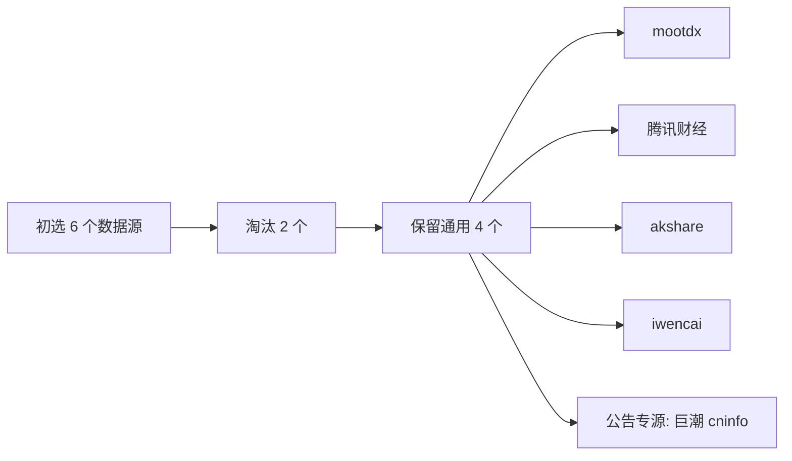

# A 股金融数据源测评与整合

归档日期：2026-05-05

本目录用于沉淀免费金融数据源的测评结论、接口测试口径和后续整合计划。所有输出仅用于量化研究辅助，不作为实盘成交确认或投资建议。

## 文件索引

| 文件 | 用途 |
|------|------|
| [interface_test_plan.md](interface_test_plan.md) | 5 个功能层面的接口测试说明、验收标准和样例代码 |
| [plan_archive_2026-05-05.md](plan_archive_2026-05-05.md) | 金融数据源测评与整合方案的计划存档 |
| [requirements-smoke.txt](requirements-smoke.txt) | 接口烟测复跑依赖，建议装到独立虚拟环境 |
| [results/2026-05-05_interface_smoke_assessment.md](results/2026-05-05_interface_smoke_assessment.md) | 2026-05-05 首轮接口烟测判读 |

## 结论摘要

本方案采用“通用数据源 + 原始专源”的组合，而不是依赖单一平台。

| 层级 | 首选方案 | 定位 |
|------|----------|------|
| 行情层 | mootdx + 腾讯财经 | 实时价格、盘口、K 线互补 |
| 研报层 | 东方财富 + akshare + iwencai | 免费研报元数据、PDF 链接和自然语言搜索 |
| 新闻层 | akshare | 个股新闻、财联社/东财/新浪/富途快讯 |
| 基础数据 | mootdx F10 | 财务字段和 F10 文本资料补充 |
| 公告层 | 巨潮 cninfo | 沪深北交所公告原始来源 |

## 接入原则

- 先小样本实测，再进入主流程，不直接批量写入 `daily_data/`、`financial_data/` 或各策略 `output/`。
- 行情和新闻类接口必须带限速、重试、缓存和空结果判定。
- 股票代码统一归一化到 Tushare 格式，如 `000001.SZ`、`600000.SH`。
- 任何接口测试结果都要记录调用时间、版本号、样例标的、行数、列名和失败原因。
- 免费接口稳定性会波动，生产封装必须提供降级路径，不把“单次成功”当作长期可用承诺。

## 参考资料

- mootdx GitHub README: https://github.com/mootdx/mootdx
- AKShare 股票数据文档: https://akshare.akfamily.xyz/data/stock/stock.html
- pywencai PyPI: https://pypi.org/project/pywencai/
- 巨潮资讯网: https://www.cninfo.com.cn/
