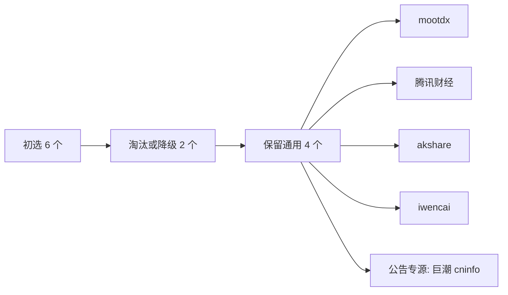

# 金融数据源测评与整合方案归档

归档日期：2026-05-05

本归档根据 6 个头部免费/低门槛数据源的可用性测评结论整理，用于后续实现统一数据访问层和 Claude Code/Codex 工作流参考。

## 一、测评框架

### 测评范围

初选数据源：

- mootdx
- 腾讯财经
- akshare
- iwencai
- Tushare
- 巨潮 cninfo

功能层面：

- 行情
- 研报
- 新闻
- 基础数据
- 公告

### 筛选结果

保留组合：

- 通用数据源：mootdx、腾讯财经、akshare、iwencai（已验证，需 IWENCAI_COOKIE）
- 公告原始专源：巨潮 cninfo

淘汰或降级：

- Tushare：保留为对照源和可选补充源，原因是 API Key 和积分权限限制。
- akshare 高频行情批量调用：降级为对照和低频补源，原因是高频调用存在限流和封禁风险。



## 二、分层解决方案

| 数据层级 | 选用方案 | 核心优势 | 淘汰或降级原因 |
|----------|----------|----------|----------------|
| 行情层 | mootdx + 腾讯财经 | TCP 协议直连通达信服务器，实时价格、五档盘口、K 线数据互补 | akshare 高频调用易限流；Tushare 受积分墙限制 |
| 研报层 | 东方财富 + akshare + iwencai | 免费研报元数据、PDF 链接、自然语言语义搜索 | Tushare 需要 API Key 和权限 |
| 新闻层 | akshare 多新闻接口 | 个股新闻、财联社电报、东财/新浪/富途快讯，适合分钟级辅助更新 | 其他候选源新闻接口覆盖不足 |
| 基础数据 | mootdx F10 | 财务摘要、除权除息、F10 文本资料补充 | akshare 高频逐股调用风险较高 |
| 公告层 | 巨潮 cninfo | 沪深北交所公告原始来源，支持公告列表与 PDF | 腾讯和通达信不适合作为公告原始接口 |

## 三、13 类数据覆盖

| 类别 | 数据 | 主源 | 备源或备注 |
|------|------|------|------------|
| 1 | 日 K | mootdx | 腾讯财经、akshare 对照 |
| 2 | 分钟线 | mootdx | 腾讯财经补充 |
| 3 | 实时价格 | mootdx | 腾讯财经补充 |
| 4 | 五档盘口 | mootdx | 交易时段小样本验证 |
| 5 | 个股研报列表 | akshare 东方财富研报 | iwencai 语义补充 |
| 6 | 研报 PDF 链接 | akshare 东方财富研报 | 仅保存链接和元数据 |
| 7 | 个股新闻 | akshare `stock_news_em` | 先做单标的小样本 |
| 8 | 财联社电报 | akshare `stock_info_global_cls` | `symbol="全部"` 或 `symbol="重点"` |
| 9 | 全球财经快讯 | akshare 东财/新浪/富途接口 | 多源去重 |
| 10 | 财务摘要 | mootdx `finance` | Tushare 可做权限内对照 |
| 11 | 除权除息 | mootdx `xdxr` | 与行情复权逻辑核对 |
| 12 | F10 文本资料 | mootdx | 作为可读资料补充 |
| 13 | 公告列表和 PDF | 巨潮 cninfo | 保留原始公告链接 |

## 四、技术实现思路

### 统一封装目标

后续可以新增只读数据层，建议命名为 `a_stock_data` 或 `financial_data_sources`。第一阶段只提供研究脚本调用，不接入现有训练和日更主流程。

建议接口：

```python
class AStockDataClient:
    def get_daily_bars(self, ts_code: str, start: str, end: str): ...
    def get_realtime_quote(self, ts_codes: list[str]): ...
    def get_research_reports(self, ts_code: str): ...
    def search_research(self, query: str): ...
    def get_stock_news(self, ts_code: str): ...
    def get_global_news(self): ...
    def get_finance_snapshot(self, ts_code: str): ...
    def get_announcements(self, ts_code: str, start: str, end: str): ...
```

### 标准化要求

- 输入统一为 Tushare 格式代码：`000001.SZ`、`600000.SH`。
- 源接口需要的裸代码、腾讯前缀代码、沪深市场编号在 adapter 内转换。
- 输出统一带 `source`、`fetched_at`、`trade_date` 或 `published_at`。
- 新闻、研报、公告必须保留原始链接。
- 批量任务必须有磁盘缓存和失败续跑能力。

### 降级顺序

| 场景 | 主源失败 | 降级 |
|------|----------|------|
| 日 K | mootdx 连接失败 | 腾讯财经，再到 akshare |
| 实时行情 | mootdx 连接失败 | 腾讯财经，只返回可用字段 |
| 研报 | akshare 东方财富研报失败 | iwencai 语义搜索 |
| 新闻 | 单一 akshare 新闻接口失败 | 其他 akshare 快讯接口补充 |
| 公告 | 巨潮查询失败 | 标记 blocked，不用非原始源替代公告事实 |
| 基础数据 | mootdx F10 失败 | Tushare 权限内字段补充 |

## 五、计划安排

| 阶段 | 工作项 | 验收物 |
|------|--------|--------|
| P0 | 按 [interface_test_plan.md](interface_test_plan.md) 做单标的烟测 | 可用性矩阵、失败清单 |
| P1 | 扩展到 20 只股票，覆盖沪深主板、创业板、科创板 | 字段字典、耗时统计、限流记录 |
| P2 | 设计统一 adapter 和缓存目录 | `AStockDataClient` 草案 |
| P3 | 将新闻、研报、公告接入研究报告的只读附录 | 报告样例，不覆盖现有 `financial_data/report.md` |
| P4 | 再评估是否制作 `a-stock-data` Claude Code Skill | Skill 草案和维护说明 |

## 六、风险与边界

- 免费接口可能因反爬策略、字段改名、网络环境和交易时段变化而失败。
- 新闻和研报不能直接作为未来收益标签的先验输入，必须按发布时间做可见性约束。
- 公告层只认巨潮原始公告作为事实来源，其他平台摘要只能作为发现线索。
- 不在 A 股交易时间内批量拉取并写入未收盘日线数据。
- 不直接覆盖现有 `daily_data/`、`financial_data/scores.csv` 或策略输出文件。

### iwencai 定性（2026-05-05 补测通过）

- pywencai 0.13.1，Node.js v22.20.0，cookie 已验证可用。
- 两个查询均通过：
  - "近一月机构评级上调的银行股" → 6 行，5,354ms
  - "近三个月研报覆盖数最多的白酒股" → 10 行，6,153ms
- 列名随问句变化，封装层只抽取 `股票代码`、`股票简称` 等固定列，其余作为附加字段保留。
- Cookie 为浏览器会话凭证，会过期；生产使用需设置 `IWENCAI_COOKIE` 环境变量，过期后重新从浏览器提取。
- 已接入 `a_stock_data.AStockDataClient.search_research(query)` 方法。

### 北交所行情来源（2026-05-05 确认）

- 当前 `filtered_stocks.csv`（2774 只）全部为沪深主板、创业板、科创板标的，含零只北交所（`.BJ`）股票。
- mootdx 不支持北交所行情的缺口对现有股票池**影响为零**，不是 P1 阻塞项。
- 如后续扩池引入北交所：akshare `stock_bj_a_spot_em` 可覆盖约 321 只北交所实时行情，届时列入行情层替补，单次全量拉取约 19 秒。

## 七、下一步

1. ~~执行 P0 烟测，生成 `results/2026-05-05_smoke.md`。~~ 已完成，见 `results/2026-05-05_interface_smoke_assessment.md`。
2. 设置 `IWENCAI_COOKIE` 并补跑 pywencai 烟测，完成 iwencai 定性。P1 不必等待此项，可并行推进。
3. 启动 P1：扩展到 20 只股票（沪深主板、创业板、科创板各取样），重点关注限流、字段变更和研报 PDF 批量耗时上限。北交所暂不纳入。
4. 根据 P1 结果整理标准字段字典。
5. 决定是否新建只读封装模块（P2）。
6. 在接口稳定后，再考虑 `a-stock-data` Skill 化（P4）。
