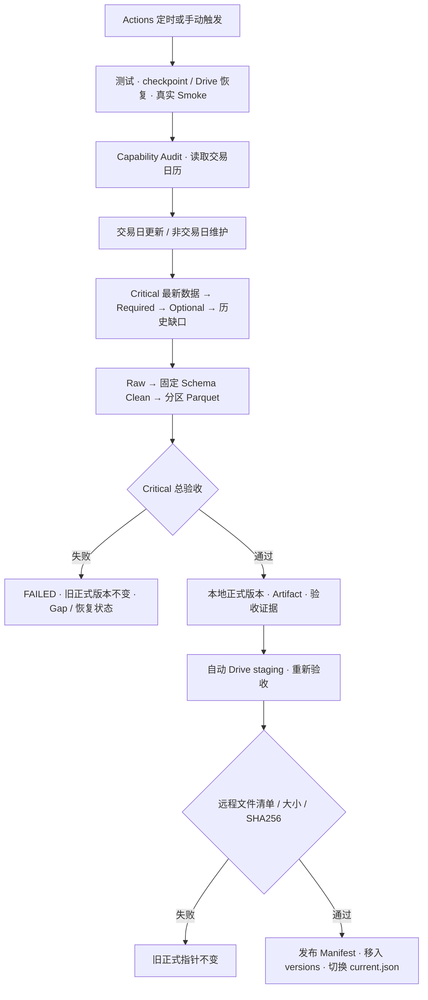

# Task 01 路线图与运行流程

本文整理已经核验的工作和接续顺序。第 19 次任务已真实强制从 Drive 恢复、继续更新并自动发布，快照日期为 **2026-10-04**。恢复报告和完整 Workflow SUCCESS 已核对，见验收记录。这是阶段验收，不代表全量历史或 Task 01 最终验收完成。

当前已经走通：**Drive 恢复 → Tushare → Raw → Clean → Parquet → Validate → Artifact → 自动 Drive staging/远程校验 → 正式版本切换 → checkpoint**。第 19 次完整任务已有真实证据，带新逻辑的定时持续运行和实际失败自动回退仍需观察。

## 已完成内容

| 阶段 | 已交付内容 | 验收状态与限制 |
| --- | --- | --- |
| 仓库与配置 | 最小模块、README、YAML、环境 Secrets、依赖、测试 | 已完成；未建立因子/模型/回测目录 |
| 数据源接入 | Tushare client、重试、Capability Audit、接口分级 | 五个 Critical 可用；扩展接口按权限处理，失败记录 Gap |
| 基础资料 | stock_basic、trade_cal、Security Master、稳定 security_id、明确板块元数据 | 已验证；严格每日研究股票池留 Task 02 |
| 存储与恢复 | Raw/Clean、固定 Schema、Date/dtype、去重、ZSTD Parquet、Hive 分区、compact、Manifest | 已实现；扫描实际文件、断点续传和失败保护已有实测 |
| 核心下载与验收 | 历史分批、最近窗口回补、缺失股票补抓、主键/非空/覆盖率验收 | 已存数据通过；历史全量仍未补齐 |
| 扩展数据 | 财务、行业、指数、市场状态、Optional 白名单的获取和落库 | 部分接口和数据已可用；完整历史、主行业体系仍待验收 |
| Actions | 单一 Workflow、20:00 北京时间 cron、手动触发、恢复 checkpoint、Smoke、验收和 Artifact | 定时维护和真实交易日回放通过；连续交易日运行待观察，GitHub 可能延迟调度 |
| Drive | OAuth、staging、远程 SHA256、Manifest、Current Pointer、Drive→Runner 恢复 | 强制恢复及恢复后自动发布已在第 19 次任务实测通过；定时持续运行、实际失败回退、版本保留仍待验证 |

本地 77 项普通测试通过，另有真实数据回放和恢复演练证据。真实首次 Drive 发布已成功；上传中断、漏文件、checksum 错误、远程读取及指针切换失败保护由离线故障测试验证。

## 当前数据进度

| 项目 | 已核验结果 |
| --- | --- |
| 快照日期 | 2026-10-04；最近交易日仍为 2026-09-30 |
| 最近交易日核心覆盖率 | daily、adj_factor、daily_basic 均为 100%，理论池 5,559 只 |
| 已存核心历史交易日 | 三类均为 67 日；包含早期边界资料，不能理解为连续最近 67 日 |
| 尚缺目标交易日 | daily 8,318；adj_factor 8,669；daily_basic 8,318 |
| Drive 正式快照 | 417 个 Parquet，503 个数据/元信息文件，共 117,020,735 字节；历史进度仍未完成 |
| 财务/行业等完整历史 | 尚未验收；extensions_history_complete 为 null |
| Drive 空间 | 上传前账号总配额 400 GiB、可用约 393.9 GiB；与其他 Google 服务共享 |

daily/basic 另有观察边界前 351 个交易日单独记录为提供者覆盖不足，不混入上述待下载日数。起止日期、请求回执或游标不能证明历史区间完整。

当前证据：[强制恢复与自动发布 #19](https://github.com/magangwwd/ashare-research-infra/actions/runs/37182687552)、[详细验收记录](acceptance-record.md)。此前第 15/18 次结果作为历史记录保留。

## 当前运行流程

Critical 下载或质量验收失败必须让数据任务失败。Required/Optional 暂时失败记录 Gap，不阻断合格的核心数据。尚未下载的历史范围不阻止已存合格快照发布，但历史未完成标记必须保留。

手动 Drive 发布入口继续存在，可读取 checkpoint 中最后一个正式版本并独立重发。常规 task01 job 在本地验收和验收 Artifact 成功后自动执行同一套发布逻辑，第 19 次任务已实测成功。发布失败会标红，恢复状态由 always() 步骤保存；定时持续运行和实际失败场景继续观察。

## 存放位置与读取方式

| 位置 | 用途 | 生命周期 |
| --- | --- | --- |
| GitHub 仓库 | 代码、配置、测试、说明 | 不存数据和业务凭据 |
| Actions Runner | 本次下载、清洗、验收、上传的临时工作目录 | GitHub 托管 Runner 在任务结束后销毁 |
| task01-validated-data Artifact | 经验收的正式数据包 | 保留 30 天，占 GitHub Artifact 存储 |
| task01-checkpoint Artifact | 上一正式版本及未完成状态，下次运行恢复 | 保留 90 天，占 GitHub Artifact 存储 |
| Drive versions | 经远程核对的不可变快照 | 当前不会自动删除旧版本 |
| Drive current.json | 唯一正式读取入口，指向已验收版本和发布清单 | 最后切换；不以文件夹创建时间判断正式版本 |

上传 Drive 不会自动清理 GitHub Artifact；现阶段继续保留检查点，避免恢复链中断。

在 [Drive 根目录](https://drive.google.com/drive/folders/1rkC99Ymgp8mjvAcJNRPJMlOGLdI9_bue) 查看 current.json。当前 [正式快照目录](https://drive.google.com/drive/folders/1TCiNBRU0fqNqTluwEpO5TRxwgmGagVtY) 为第 19 次任务发布的版本，含 417 个 Parquet、503 个数据/元信息文件、约 117 MB；三类核心均有 67 个已存交易日通过检查。旧版本仍保留。消费者应验证指针和 Manifest，不读取 staging。

## 后续路线图

历史补齐和每日更新继续并行运行；以下是 Drive 接续开发和最终验收的顺序，尚未开始的新功能不能记为完成。

1. **第二次正式发布：已完成。** 第二次真实发布已验证 staging 期间旧指针不变、远程校验后才切换；新版本可读、previous_version 正确，首次版本目录和 Manifest 仍可恢复，staging 最终为空。
2. **验收后自动上传：真实任务已通过，定时持续运行待观察。** 第 19 次常规 task01 job 在恢复、更新和验收后自动上传，远程校验、正式指针切换及 checkpoint 保存均通过。本次为手动触发的恢复演练，带新发布逻辑的每日定时运行还需持续验证。
3. **Drive 恢复链：真实强制恢复已通过。** 第 19 次任务主动忽略 GitHub checkpoint，从 Drive 恢复 482 个文件、109,617,924 字节；远程清单、逐文件 SHA256、本地 Critical 验收均通过，之后更新及自动发布成功。恢复报告 source=google_drive_current，已独立下载核对。checkpoint 缺失/损坏时自动回退的代码保留，实际失败自动回退继续观察。
4. **制定并实现保留策略。** 明确 Drive 版本数、行情 Raw 保留、财务 Raw 长期保留和 Artifact 配额；恢复链验证成功后再清理冗余产物。当前发布每次上传完整快照，远程增量/续传尚未实现，随历史增长再优化。
5. **持续补齐与审计历史：Core Backfill 快车道已接入，待真实运行验收。** 最新数据、最近窗口、Required/Optional 刷新和修复优先级不变；进入历史阶段后，在最近 750 个交易日的 daily / adj_factor / daily_basic 尚未补齐前，将 75% 的历史预算保留给三类核心行情，另外 25% 继续给财务、行业、指数和 Optional 历史，避免扩展数据饿死。维护模式 240 个历史预算单位对应约 180 Core + 60 其他；交易日模式 40 对应约 30 + 10。达到 750 日目标后自动回到全数据 round-robin，不永久偏向行情。所有 Core 文件仍必须通过原有覆盖率、Gap、Schema、主键和 Critical 验收后才计为完成。下一次正常 task01 运行需核对 metadata/manifest/history.json 中 core_fetched_this_run / other_fetched_this_run 和核心交易日实际增长，才能把快车道标记为运行验收通过。
6. **执行 Task 01 最终验收。** 联合检查历史范围、Critical 质量、连续交易日和维护运行、历史修订、断点恢复、Drive 发布及失败保护，形成完整验收记录。
7. **进入 Task 02。** 从经验证的 Clean 开始，再建立 curated/factors，处理严格股票池、每日状态、动态复权和因子研究。Task 01 不提前实现这些功能。

操作入口：Actions → Task 01 data infrastructure → Run workflow；默认三个选项都不勾选执行数据更新并自动发布；仅勾选 force_drive_restore 强制从 Drive 恢复后继续完整任务；仅勾选 publish_drive_snapshot 发布现有快照；仅勾选 verify_drive_auth 检查授权。具体规则见 [Drive 发布说明](drive-phase2.md)。
